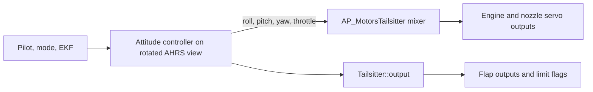

# Raven: twin turbojet vectored-nozzle tailsitter

Raven is a twin turbojet VTOL drone. It takes off and lands on its tail. Its only control effectors are two engine nozzles, each with two axes of thrust vectoring, and two trailing-edge flaps.

It runs on stock ArduPlane in QuadPlane tailsitter mode (`Q_FRAME_CLASS 10`). No new vehicle type is added. This document describes the local changes that give each nozzle a second axis and explains how control works.

**Status:** AI-assisted, local testing only. The changes have not been compiled, run in SITL, benched or flown. Do not fly with engines running before completing [Bring-up](#bring-up).

## Contents

- [Changes](#changes)
- [Servo functions](#servo-functions)
- [Control mechanics](#control-mechanics)
- [Flight phases](#flight-phases)
- [Parameters](#parameters)
- [Simulation](#simulation)
- [Bring-up](#bring-up)
- [Known limitations](#known-limitations)

## Changes

| File | Change |
|---|---|
| `libraries/SRV_Channel/SRV_Channel.h` | Adds `k_tiltMotorLeftRoll` (190) and `k_tiltMotorRightRoll` (191) |
| `libraries/SRV_Channel/SRV_Channel.cpp` | Documents values 190 and 191 for `SERVOn_FUNCTION` |
| `libraries/SRV_Channel/SRV_Channel_aux.cpp` | Gives both functions an angle range |
| `libraries/AP_Motors/AP_MotorsTailsitter.h` | Adds `_tilt_roll` and `_has_lateral_tilt` |
| `libraries/AP_Motors/AP_MotorsTailsitter.cpp` | Routes roll to the lateral nozzle servos instead of differential thrust, when assigned |
| `ArduPlane/tailsitter.cpp` | Centres the lateral servos in the fixed-wing branch and reports their saturation as a roll limit |
| `Tools/Frame_params/QuadPlanes/Raven.param` | Parameter set for the airframe |

If neither function 190 nor 191 is assigned, behaviour is identical to upstream.

## Servo functions

| Function | ID | Role |
|---|---|---|
| `ThrottleLeft` | 73 | Left engine |
| `ThrottleRight` | 74 | Right engine |
| `TiltMotorLeft` | 75 | Left nozzle, pitch/yaw axis |
| `TiltMotorRight` | 76 | Right nozzle, pitch/yaw axis |
| `ElevonLeft` | 77 | Left flap |
| `ElevonRight` | 78 | Right flap |
| `TiltMotorLeftRoll` | 190 | Left nozzle, lateral (roll) axis |
| `TiltMotorRightRoll` | 191 | Right nozzle, lateral (roll) axis |

`Raven.param` assigns these to servos 1 to 8 in the order shown, with 75 on servo 4 and 76 on servo 3. Changing a servo function needs a reboot, because `_has_lateral_tilt` is read once in `AP_MotorsTailsitter::init()`.

## Control mechanics

### Signal flow



### Frames

The tailsitter rotates the AHRS view by 90 degrees of pitch. The multicopter-style controller therefore treats nose-up as level. In this view:

- Copter roll is the aircraft's yaw axis.
- Copter pitch is the aircraft's pitch axis.
- Copter yaw is the aircraft's roll axis, a spin about the nose.

### Hover mixer

`AP_MotorsTailsitter::output_armed_stabilizing()` takes normalised roll, pitch and yaw commands (-1 to 1) and a throttle, and produces:

| Quantity | Value |
|---|---|
| Engine thrust, each | `throttle` (equal on both engines) |
| Left nozzle pitch/yaw tilt | `pitch - yaw` |
| Right nozzle pitch/yaw tilt | `pitch + yaw` |
| Lateral tilt, both nozzles | `roll` limited to -1 to 1 |

`output_to_motors()` scales tilt values by 4500 to the servo angle range, and writes engine outputs according to the motor spool state.

In upstream, roll is produced by thrusting the two engines differentially. With a lateral servo assigned, `_has_lateral_tilt` is true and the differential term is zero.

### Axis authority

| Axis | Nozzle action | Moment arm |
|---|---|---|
| Pitch | Both nozzles deflect fore/aft together | Distance from nozzle to centre of gravity |
| Roll | Both nozzles deflect sideways together | Distance from nozzle to centre of gravity |
| Yaw (spin about the nose) | Nozzles deflect fore/aft in opposite directions | Half the nozzle spacing |

Authority is proportional to thrust. Close nozzle spacing gives weak yaw authority.

### Left and right assignment

The mixer was written for tailsitters whose engines sit above the centre of gravity in hover. Raven's nozzles sit below it. Pitch torque from a fore/aft force flips sign with that position, but yaw torque from a differential force does not. With the stock mixer, pitch and yaw are both correct only if the nozzle assigned to the `TiltMotorLeft` function (75) is physically on the aircraft's right side, and the other nozzle is assigned to `TiltMotorRight` (76).

This comes from a sign analysis, not from a test. The SITL model uses this assignment, so the simulation checks it. On hardware, wire or reassign the servos to match, then confirm with the bench test.

### Surfaces in hover

`Tailsitter::output()` copies the copter controller outputs to the aileron, elevator and rudder channels, multiplied by `Q_TAILSIT_VT_Y_P`, `VT_P_P` and `VT_R_P`. These are 0 in `Raven.param`, so the flaps stay neutral in hover.

Pitch/yaw tilt is multiplied by `Q_TAILSIT_VHGAIN` (1 in `Raven.param`). When pitch error is large, an extra pitch tilt is added using a power law (`Q_TAILSIT_VHPOW`) so the nozzles can point fully upward for takeoff without integrator windup.

### Saturation

If either pitch/yaw nozzle servo reaches its limit, `motors->limit.pitch` and `limit.yaw` are set. If the lateral servo reaches its limit, `limit.roll` is set. The attitude controller uses these to stop integrators building up.

## Flight phases

| Phase | Controlling effectors |
|---|---|
| Hover (Q modes) | Nozzles only |
| Forward flight to hover transition (`ANGLE_WAIT_VTOL`) | Flaps only, nozzles centred |
| Hover to forward flight, pitching over (`ANGLE_WAIT_FW`) | Nozzles only |
| Forward flight | Flaps only, nozzles centred |

**Hover to forward flight.** The aircraft pitches forward at `Q_TAILSIT_RAT_FW` until it passes `Q_TAILSIT_ANGLE` (45 degrees by default). Until then `Tailsitter::active()` is true and the nozzle-only controller runs. After that, fixed-wing control takes over.

**Forward flight to hover.** While `in_vtol_transition()` is true, `Tailsitter::output()` takes the fixed-wing branch:

- Throttle is set to hover level (`Q_TAILSIT_THR_VT` of -1 uses hover throttle).
- Nozzle tilt is `Q_TAILSIT_VFGAIN` times the surface demand. It defaults to 0, so the nozzles stay centred.
- The lateral servos are set to 0.

Attitude is therefore controlled by the flaps alone at low airspeed until the aircraft pitches up through `Q_TAILSIT_ANG_VT`. See [Known limitations](#known-limitations).

**Forward flight.** Standard ArduPlane control. Throttle goes to both engines equally.

## Parameters

Set by `Raven.param`:

| Parameter | Value | Meaning |
|---|---|---|
| `Q_ENABLE` | 1 | Enable QuadPlane |
| `Q_FRAME_CLASS` | 10 | Tailsitter motor class |
| `Q_TAILSIT_ENABLE` | 1 | Enable tailsitter logic |
| `Q_TAILSIT_VHGAIN` | 1 | Full nozzle gain in hover (upstream default 0.5) |
| `Q_TAILSIT_VT_R_P` | 0 | No surface output for copter roll |
| `Q_TAILSIT_VT_P_P` | 0 | No surface output for copter pitch |
| `Q_TAILSIT_VT_Y_P` | 0 | No surface output for copter yaw |

Not set, and needed before flight: `SERVOn_MIN`, `SERVOn_MAX`, `SERVOn_TRIM`, `SERVOn_REVERSED`, attitude gains (`Q_A_*`), the engine throttle range, and the thrust curve.

## Simulation

SITL has a Raven model: `quadplane-raven`. It is a QuadPlane model with a two-engine frame in which each engine has a pitch and a roll nozzle servo, and the flaps are mixed as elevons.

| File | Purpose |
|---|---|
| `libraries/SITL/SIM_Frame.cpp` | Adds the `raven` two-engine frame with two tilt axes per engine |
| `libraries/SITL/SIM_QuadPlane.cpp` | Selects the `raven` frame and applies the tailsitter rotation |
| `Tools/autotest/models/raven.json` | Mass, inertia, nozzle positions, engine thrust and aero coefficients |
| `Tools/autotest/default_params/quadplane-raven.parm` | Servo layout and first gain estimates |
| `Tools/autotest/pysim/vehicleinfo.json` | Registers the frame for `sim_vehicle.py` |

Run it on Linux, or in WSL, with:

```sh
Tools/autotest/sim_vehicle.py -v ArduPlane -f quadplane-raven --console --map
```

The SITL servo layout differs from the hardware one: flaps on servos 1 and 2, engines on 5 and 6, pitch/yaw nozzles on 7 and 8, and roll nozzles on 9 and 10.

Every number in `raven.json` is a placeholder. The engine model is the generic electric motor model, with a one second spool and no jet-specific behaviour. The aero coefficients are copied from a small fixed-wing model, so hover is meaningful but forward flight is not.

## Bring-up

1. Build for your flight controller board and for SITL, and fix any compile errors.
2. Bench test with engines removed or off. Arm in `QHOVER` or `QSTABILIZE`, tilt the airframe by hand, and check each axis against the table below. Fix directions with `SERVOn_REVERSED`.
3. Check nozzle end stops and trims, and confirm that flaps stay neutral in hover.
4. Test tethered, with a kill switch and someone able to cut the engines.

A restoring force must push the tail toward the side the nose is leaning to, so the exhaust must deflect away from the lean.

| Disturbance | Correct nozzle response |
|---|---|
| Nose leans forward | Both exhausts deflect aft |
| Nose leans right | Both exhausts deflect left |
| Aircraft spins about the nose | Exhausts deflect fore/aft in opposite directions, opposing the spin |

Left and right servos are usually mounted mirrored, so expect to reverse one servo in each pair.

## Known limitations

- **Back-transition control.** Flaps alone control the aircraft from forward flight to hover. Setting `Q_TAILSIT_VFGAIN` above 0 and adding lateral output in that branch would address this. Neither is done.
- **Roll sign is unverified.** The existing differential-thrust roll sign is known. The lateral roll sign assumes the same convention and was not checked against the airframe.
- **Motor test.** `_output_test_seq` covers only the engines and the pitch/yaw tilt servos, not the lateral servos.
- **Thrust scaling.** Lateral authority is not scaled with thrust, and nothing limits it at low thrust.
- **Turbojet behaviour.** Nothing handles engine spool lag, idle thrust, start and stop sequences, ECU faults, or a single-engine failure.
- **Tail-sitting ground handling.** Takeoff, landing and rangefinder setup are not configured.
- **SITL model is a placeholder.** It uses the generic motor model and placeholder mass, inertia and aero. It can check signs, wiring and loop stability, not real performance.
- **Servo function IDs.** 190 and 191 were chosen locally and may conflict with future upstream functions. They also enlarge the servo tables on every vehicle.
