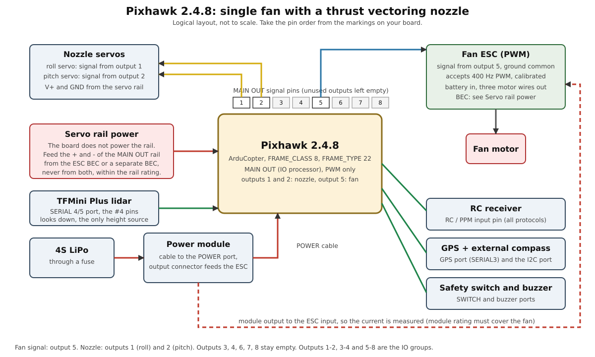

# Deploying the single-fan thrust vectoring VTOL to a Pixhawk 2.4.8

Build, flash, wire, configure and test, in the order you do it. Overview and what was verified: [README.md](README.md). Starting
parameters: [edf_tvc_pixhawk.param](edf_tvc_pixhawk.param). Diagram: [wiring.svg](wiring.svg).

> **Experimental and safety-critical. Never flown.** The firmware was tested in SITL only. Nothing here has been run on a
> Pixhawk. Every number that depends on your airframe is a starting value to be measured. The change is AI-assisted and is
> not in upstream ArduPilot.
>
> **There is no yaw control.** A 2-axis nozzle gives roll and pitch torque only. The fan's reaction torque will turn the
> airframe and nothing in the vehicle can counter it. No simulation shows how fast. Stay on a tether until you know.

## 1. What you need

| Item | Notes |
|------|-------|
| Pixhawk 2.4.8 | the Pixhawk1 / FMUv3 layout, STM32F427, with the IO processor |
| Fan with a 2-axis nozzle | pivot **below** the centre of gravity, hard stops at the largest angle you want |
| Two servos | one per nozzle axis, with metal gears and no binding over the travel |
| Fan ESC | PWM input that accepts **400 Hz**. MAIN outputs have no DShot |
| Battery and power module | 4S in this guide. Check the module rating against your battery and the fan current |
| BEC | for the servo rail, within what the board and the servos accept |
| RC receiver, GPS with external compass, safety switch, buzzer | the safety switch is required for the fan output to move and for arming. |
| Fuse or breaker | in the battery lead |
| Tether, thrust stand, multimeter | the tests in sections 9 to 13 need them |
| A computer | Linux or Windows, USB cable, Mission Planner or QGroundControl |

For the build: this source tree, the ARM toolchain used by it (`arm-none-eabi-gcc` 10-2020-q4) and Python 3. Do not use `sudo`
with `waf`.

## 2. Before you start

* The branch is `single-motor-thrust-vector-pixhawk`. Record the commit (`git rev-parse HEAD`) and keep `git diff` with every
  firmware you fly, so a log can be tied to its source.
* **Which firmware: 2 MB or 1 MB.** Many Pixhawk 2.4.8 boards carry a 2 MB STM32F427. Some carry a chip revision limited to
  1 MB. There are two builds: `Pixhawk1` (2 MB) and `Pixhawk1-1M` (1 MB, reduced features). The firmware checks this at
  start: `Pixhawk1` stops with `ERROR: 1M flash use Pixhawk1-1M`, and `Pixhawk1-1M` stops with `2M flash - use Pixhawk1 firmware`
  on a 2 MB board. Start with `Pixhawk1` and use the other one if you get that message.
* **Official firmware must never be loaded.** Do not use "Install firmware" from the firmware server and do not accept update
  prompts. It has no frame type 22.

## 3. Build

```bash
cd ~/ardupilot
git switch single-motor-thrust-vector-pixhawk
./waf configure --board Pixhawk1        # or Pixhawk1-1M
./waf copter
```

The build ends with `'copter' finished successfully`. Measured here:

| Target | Flash used | Free | Output |
|--------|-----------|------|--------|
| `Pixhawk1` | 1,577,436 B | 503,328 B | `build/Pixhawk1/bin/arducopter.apj` |
| `Pixhawk1-1M` | 967,412 B | 64,768 B | `build/Pixhawk1-1M/bin/arducopter.apj` |

Both have board ID 9. Check what you built:

```bash
python3 -c "import json;d=json.load(open('build/Pixhawk1/bin/arducopter.apj'));print(d['board_id'],d['image_size'])"
```

Copy `build/<board>/bin/` somewhere safe together with the `git diff`. Building for another board later does not delete it, but it
is easy to flash the wrong file.

## 4. Flash

Propellers off, the fan unable to run, the battery disconnected. USB only.

**Mission Planner.** Setup, Install Firmware, "Load custom firmware", pick `arducopter.apj`, and follow the prompts.

**Command line.** With the board on USB and no ground station connected:

```bash
python3 Tools/scripts/uploader.py build/Pixhawk1/bin/arducopter.apj
```

If it waits for the bootloader, unplug and replug the USB cable. Add `--port /dev/ttyACM0` (or the port of your board) if it is
not found. On Linux your user needs access to the serial port (the `dialout` group).

**After flashing.** The firmware updates the IO processor on its first boot if it needs to. This was not tried on a board, so
wait until the LEDs settle. Connect the ground station and read the messages:

* the banner reads `ArduCopter V4.8.0-dev`;
* after section 7 and a reboot, `Frame: SINGLE/TVC`. Anything else means the wrong frame parameters or the wrong firmware.
  Do not go on.

| Symptom | Action |
|---------|--------|
| the uploader does not see the board | different cable (data, not charge only), different USB port, replug while it waits |
| `ERROR: 1M flash use Pixhawk1-1M` | flash the `Pixhawk1-1M` build |
| `2M flash - use Pixhawk1 firmware` | flash the `Pixhawk1` build |
| board type mismatch | check the board ID is 9. Do not use `--force` unless you know why it differs |
| no `Frame: SINGLE/TVC` | `FRAME_CLASS` is not 8 or `FRAME_TYPE` is not 22 (section 7) |

## 5. Wiring



The figure is logical, not to scale. **Take pin order and orientation from the markings on your board.** Pixhawk 2.4.8 boards
from different makers differ in small ways.

### 5.1 Connections

| Item | Goes to | ArduPilot |
|------|---------|-----------|
| nozzle roll servo, signal | MAIN OUT 1 | Motor1, `SERVO1_FUNCTION` 33 (default) |
| nozzle pitch servo, signal | MAIN OUT 2 | Motor2, `SERVO2_FUNCTION` 34 (default) |
| fan ESC, signal and ground | MAIN OUT 5 | Motor5, `SERVO5_FUNCTION` 37 (default) |
| servo power | the + and - of the MAIN OUT rail | not from the board, see 5.3 |
| power module | POWER port | `BATT_MONITOR` 4 |
| RC receiver | the RC input pin at one end of the servo rail | |
| GPS | GPS port | SERIAL3 |
| external compass | I2C port, or inside the GPS module | |
| safety switch | SWITCH port | |
| buzzer | the buzzer port | |
| Benewake TFMini Plus lidar (altitude) | SERIAL 4/5 port, the `#4` pins | SERIAL4, `SERIAL4_PROTOCOL` 9, `RNGFND1_TYPE` 20 |
| telemetry radio (optional) | TELEM1 | SERIAL1 |

Outputs 3, 4, 6, 7 and 8 stay empty. The default output functions already give this mapping, so no `SERVOn_FUNCTION` has to be
set. The mixer only creates Motor1, Motor2 and Motor5.

### 5.2 The MAIN outputs

* MAIN OUT is driven by the IO processor, PWM only. The three timer groups are outputs 1-2, 3-4 and 5-8. The fan output runs
  at 400 Hz, and the servos, which are in another group, stay at 50 Hz. Do not put a servo on outputs 5 to 8: it would be at 400 Hz.
* Each output has three pins: signal, +, and -. The V+ and - of all outputs are the servo rail, shared by all outputs. Use the
  signal pin of the output for the signal wire.
* The fan ESC needs only the signal and the ground. **Do not connect the ESC's BEC (red) wire to the rail if a separate BEC
  feeds it** (see 5.3).

### 5.3 Power

* **Board power.** Battery to the power module, and the power module's 6-pin cable to the POWER port. The power module gives the
  board its 5 V and the voltage and current readings (`BATT_VOLT_MULT` 10.1, `BATT_AMP_PERVLT` 17.0 in the parameter file, the
  values for the standard module). USB can power the board for the bench tests, but it does not power the servo rail or the ESC.
* **Fan power.** The power module's output connector to the ESC input, so the current is measured. The module's current rating
  must cover the fan. If it does not, take the ESC from the battery directly, with its own fuse, and accept that the current
  reading will not include the fan.
* **Servo rail.** The board does not power the servo rail. Feed the rail's + and - from the ESC's BEC or from a separate BEC,
  **never from both**, at a voltage within what the board and the servos accept. Check the rail limit in your board's
  documentation. A BEC that is a good deal larger than the servo current is preferable to a small one.
* **One ground.** Battery -, ESC -, BEC -, the rail and the board share the ground.
* **Fuse** the battery lead. Use wire sized for the fan current, short and twisted, and keep it away from the signal wires.

### 5.4 Pin tables

From the board's `hwdef` README (`libraries/AP_HAL_ChibiOS/hwdef/Pixhawk1/README.md`). Pin 1 is the red wire. Check against your board.

**POWER**

| Pin | Signal | Level |
|-----|--------|-------|
| 1 (red) | VCC | +5 V |
| 2 | VCC | +5 V |
| 3 | CURRENT | up to +3.3 V |
| 4 | VOLTAGE | up to +3.3 V |
| 5 | GND | |
| 6 | GND | |

**SWITCH (safety)**

| Pin | Signal | Level |
|-----|--------|-------|
| 1 (red) | VCC | +3.3 V |
| 2 | !IO_LED_SAFETY | GND |
| 3 | SAFETY | GND |

**GPS**

| Pin | Signal | Level |
|-----|--------|-------|
| 1 (red) | VCC | +5 V |
| 2 | TX (out of the board) | +3.3 V |
| 3 | RX (into the board) | +3.3 V |
| 4 | CAN2 TX | +3.3 V |
| 5 | CAN2 RX | +3.3 V |
| 6 | GND | |

**I2C**

| Pin | Signal | Level |
|-----|--------|-------|
| 1 (red) | VCC | +5 V |
| 2 | SCL | +3.3 V (pull-ups) |
| 3 | SDA | +3.3 V (pull-ups) |
| 4 | GND | |

**TELEM1 / TELEM2**

| Pin | Signal | Level |
|-----|--------|-------|
| 1 (red) | VCC | +5 V |
| 2 | TX (out) | +3.3 V |
| 3 | RX (in) | +3.3 V |
| 4 | CTS | +3.3 V |
| 5 | RTS | +3.3 V |
| 6 | GND | |

**SERIAL 4/5 port** (the TFMini Plus lidar goes on the `#4` pair)

| Pin | Signal | Level |
|-----|--------|-------|
| 1 (red) | VCC | +5 V |
| 2 | TX (#4), out of the board | +3.3 V |
| 3 | RX (#4), into the board | +3.3 V |
| 4 | TX (#5) | +3.3 V |
| 5 | RX (#5) | +3.3 V |
| 6 | GND | |

Serial ports: SERIAL0 USB, SERIAL1 TELEM1, SERIAL2 TELEM2, SERIAL3 GPS, SERIAL4 and SERIAL5 on the 6-pin port.
Device TX goes to the board RX, and device RX to the board TX.

### 5.5 Receiver, GPS and compass

* **Receiver.** The RC input pin at one end of the servo rail takes all the usual protocols (PPM, SBUS and others). It needs its
  5 V from the rail or the board. If you power it from the rail, it comes from the BEC.
* **GPS and compass.** Fit a GPS with an external compass on a mast, away from the fan motor, the ESC and the battery wires: the
  fan current is large. The board's own LSM303D compass is subject to interference and is not suitable here. Set the orientation
  of the external compass (`COMPASS_ORIENT`, `COMPASS_ORIENT2` or `COMPASS_ORIENT3`, for whichever instance is the external one) to
  match its mounting.
* **Telemetry radio (optional).** TELEM1.

### 5.5a Altitude lidar: Benewake TFMini Plus

It is the **only height source** (`EK3_SRC1_POSZ` 2): the barometer is not used for height. Without a good lidar reading the EKF has no
height. Read the ArduPilot page for it (ardupilot.org, "Benewake TFmini / TFmini Plus lidar") and the Benewake datasheet for your unit.

| Lidar wire | Goes to | Note |
|------------|---------|------|
| +5 V | SERIAL 4/5 port pin 1 | check the supply current in the datasheet. The port's 5 V is shared with the GPS and the rest of the board |
| GND | pin 6 | |
| TXD (lidar sends) | pin 3, RX (#4) | the lidar's transmit goes to the board's receive |
| RXD (lidar receives) | pin 2, TX (#4) | |

**Wire colours differ between sellers and versions.** Do not use a colour table from memory or from a web page: read the pinout printed in
the datasheet of your unit, and check it with a multimeter before applying power. The sensor's UART default is 115200 baud 8N1, which is
`SERIAL4_BAUD` 115.

Mount it looking straight down along the body (orientation 25, pitch 270), clear of the exhaust and of the nozzle's travel, so the beam
cannot hit the fan, a leg or a wire. The sensor sees the ground, not the vehicle's feet: `RNGFND1_GNDCLR` is the distance from the
sensor to the ground with the vehicle standing on its feet, **measured, in metres**, and it must be at least `RNGFND1_MIN` (0.1).
Shiny, transparent or very dark floors, and bright sunlight, make a lidar misread. Fly it over a matt, flat surface.

### 5.6 Mechanical

* The nozzle roll and pitch axes pivot **below the centre of gravity**, and the exhaust leaves through the pivot. Hard stops at
  the largest angle you want. Set `SERVO1/2_MIN/MAX` to the pulses at the stops.
* Nothing may reach the fan inlet or the nozzle travel: secure every wire. A connector that comes loose on a vehicle whose only
  actuators are the nozzle and the fan is a crash.
* Mount the board on soft mounts if the fan vibration is high. Watch `VIBE` in the first logs.
* Keep the board's arrow pointing forward, and the board level, or set `AHRS_ORIENTATION` and the trim.

### 5.7 Continuity and polarity check

Battery disconnected, with a multimeter.

| Check | Expected |
|-------|----------|
| battery + to power module in, to ESC + | continuity |
| battery - to ESC - to BEC - to the rail - to the board ground | continuity |
| battery + to battery - | no continuity |
| the rail + to the rail - | no short |
| servo rail + to the board's 5 V | no continuity (no second supply on the rail) |
| MAIN OUT 5 signal to the ESC signal | continuity |
| the signals of outputs 1, 2 and 5 to each other | no continuity |

Then power from USB and check that the sensors report, and check the BEC voltage with the multimeter before connecting the
servos. Only then connect the battery, with the fan restrained and clear.

### 5.8 Wiring checklist

- [ ] Roll servo on output 1, pitch servo on output 2, fan ESC on output 5
- [ ] Outputs 3, 4, 6, 7, 8 empty
- [ ] One servo rail supply only, voltage checked, ground common
- [ ] Power module on the POWER port, fan current within its rating
- [ ] Safety switch and buzzer fitted
- [ ] Receiver, GPS, compass connected, TX and RX crossed correctly
- [ ] Battery polarity checked, fuse fitted
- [ ] No wire can reach the inlet or the nozzle travel
- [ ] The nozzle moves through its full range without binding

## 6. First power-up (USB only)

1. Connect USB, no battery. The board starts and the ground station connects.
2. Check the sensors report (accelerometer, gyro, barometer, compass) and the GPS is detected.
3. Press the safety switch. The LED shows the state (flashing is safe, solid is unsafe). Arming needs the switch pressed. The
   board sets `BRD_SAFETY_MASK` by default so that every output that is not a motor ignores the switch. In this frame only the fan
   (output 5) is a motor, so, from reading the code, **the fan output stays off until the switch is pressed and the nozzle servos
   move with the switch on**. This was not tried on a board: check it with the fan unable to run.

## 7. Parameters

1. Reset all parameters to default (Mission Planner: Config, Full Parameter List, Reset to Default). Reboot.
2. Load [edf_tvc_pixhawk.param](edf_tvc_pixhawk.param), write, reboot. It switches the battery monitor on (`BATT_MONITOR` 4) and
   reports nothing missing.
3. **Battery settings, after the reboot.** The battery scales and failsafes (`BATT_VOLT_MULT`, `BATT_AMP_PERVLT`, `BATT_LOW_VOLT`,
   `BATT_CRT_VOLT`, `BATT_FS_LOW_ACT`, `BATT_FS_CRT_ACT`) do not exist on the board until `BATT_MONITOR` is 4 and it has rebooted, so
   they are in [edf_tvc_pixhawk_battery.param](edf_tvc_pixhawk_battery.param). Before loading it:
   * In the full parameter list, check `BATT_MONITOR` reads **4**. If it reads 0, the first file was not written to the board:
     set it to 4 by hand, write, reboot.
   * Make the ground station re-read the parameters from the board (Mission Planner: **Refresh Params**, or disconnect and
     reconnect). A ground station that still holds the old list reports the six as missing (`No matching Params`) even when the
     board has them.
   * Search the list for `BATT_VOLT_MULT`. When it is there, load the battery file and write. `BATT_VOLT_MULT` and `BATT_AMP_PERVLT`
     only appear after a **reboot** with `BATT_MONITOR` at 4. The four others (`BATT_LOW_VOLT`, `BATT_CRT_VOLT`, `BATT_FS_LOW_ACT`,
     `BATT_FS_CRT_ACT`) appear as soon as it is set, so before the reboot the ground station reports only those two as missing.
   If the six are still missing with `BATT_MONITOR` at 4 after a refresh, stop and report it: the firmware on the board is not
   this build.
4. **Lidar settings, last.** The first file switched the rangefinder on (`RNGFND1_TYPE` 20, `SERIAL4_PROTOCOL` 9, `SERIAL4_BAUD` 115).
   Its other settings (`RNGFND1_MIN`, `MAX`, `GNDCLR`, `ORIENT`) do not exist on the board until `RNGFND1_TYPE` is non-zero, so they are in
   [edf_tvc_pixhawk_lidar.param](edf_tvc_pixhawk_lidar.param), the same pattern as the battery file. Before loading it:
   * Refresh the parameters in the ground station (as in step 3) and check `RNGFND1_MIN` is in the list.
   * Check the lidar works: Mission Planner, Flight Data, Status tab, **`rangefinder1`** must show a distance that follows your hand
     under the sensor. If it shows 0 or nothing, stop: check the wiring (TX and RX crossed), the 5 V, and `SERIAL4_BAUD`.
   * **Measure `RNGFND1_GNDCLR`** (sensor to ground with the vehicle on its feet) and put the number in the file first. The placeholder 0.20 is
     not your vehicle.
   Then load the file and write. It ends by setting `EK3_SRC1_POSZ` 2, so the EKF height comes from the lidar from then on. Reboot.
5. Check: `FRAME_CLASS` 8, `FRAME_TYPE` 22, `SERVO1_FUNCTION` 33, `SERVO2_FUNCTION` 34, `SERVO5_FUNCTION` 37, the others 0, and
   `Frame: SINGLE/TVC` in the messages. With the vehicle on its feet `rangefinder1` must read your `RNGFND1_GNDCLR`, within a few
   centimetres.
6. Calibrate the accelerometers (the vehicle level on its legs), the compass (after the compass is mounted and the wiring done)
   and the radio.
7. Set the flight mode switch: Stabilize, AltHold, Loiter, Land.
8. Assign a **motor emergency stop** switch. The file uses `RC7_OPTION` 31. Test it with the fan unable to run.
9. Calibrate the battery readings: `BATT_VOLT_MULT` and `BATT_AMP_PERVLT` against a meter.

| Parameter | In the file | Meaning, and how to set it |
|-----------|-------------|----------------------------|
| `SERVO1/2_MIN/MAX` | 1100 / 1900 | pulse at each nozzle stop. Sets the nozzle angle at full demand |
| `SERVO1/2_TRIM` | 1500 | pulse for a centred nozzle |
| `SERVO1/2_REVERSED` | 0 | change if the directions in section 8 are wrong |
| `MOT_PWM_TYPE`, `MOT_PWM_MIN/MAX` | 0, 1000, 2000 | PWM ESC range |
| `MOT_THST_EXPO` | 0.5 | fan thrust curve. Measure it on a thrust stand |
| `MOT_THST_HOVER` | 0.35 | hover throttle: weight over the thrust at full throttle, then learned |
| `MOT_SPIN_ARM`, `MOT_SPIN_MIN` | 0.06, 0.10 | idle: the lowest throttle at which the fan runs smoothly |
| `MOT_BAT_VOLT_MAX/MIN` | 16.8, 13.2 | 4.2 V and 3.3 V per cell, 4S |
| `ATC_ANGLE_MAX` | 15 | maximum lean in degrees. Raise after the tether tests |
| `ATC_RAT_RLL/PIT_P,I,D` | 0.20, 0.20, 0.005 | too low a gain oscillates in the Gazebo model. Chosen there (section 17). Tune on the tether |
| `FS_THR_ENABLE` | 3 | land when the radio is lost |
| `BATT_LOW_VOLT`, `BATT_CRT_VOLT`, `BATT_FS_*_ACT` | 14.0, 13.2, land | 3.5 V and 3.3 V per cell, 4S |
| `RNGFND1_TYPE`, `SERIAL4_PROTOCOL`, `SERIAL4_BAUD` | 20, 9, 115 | TFMini Plus on SERIAL4 (the lidar file adds the rest) |
| `RNGFND1_MIN`, `RNGFND1_MAX` | 0.1, 6 | the sensor reads 0.1 to 12 m. 6 is ArduPilot's outdoor figure, use up to 10 indoors |
| `RNGFND1_GNDCLR` | 0.20 | **measure**: sensor to ground with the vehicle on its feet |
| `EK3_SRC1_POSZ` | 2 | EKF height from the lidar. **Only height source**: the barometer is not used |
| `PILOT_TKO_ALT_M` | 0.5 | altitude of a throttle take-off, see 7a |
| `PILOT_SPD_UP`, `WP_SPD_UP` | 0.5 | climb rate limit, m/s |
| `FENCE_ENABLE`, `FENCE_TYPE`, `FENCE_ALT_MAX`, `FENCE_ACTION` | 1, 1, 0.8, 2 | altitude ceiling 0.8 m above home, then land. See 7a |

For another battery size, change `MOT_BAT_VOLT_*`, `BATT_LOW_VOLT` and `BATT_CRT_VOLT` (3.5 V and 3.3 V per cell for the two
failsafes) and check the power module rating.

### 7a. Altitude: the 0.5 m working height

* **What 0.5 m means.** ArduCopter compares its target with the **lidar reading**, and does not subtract `RNGFND1_GNDCLR`. A take-off to 0.5 m
  therefore ends with the lidar reading 0.5 m, which is **0.5 minus `RNGFND1_GNDCLR`** above the feet (0.31 m with a clearance of 0.19 m). If
  you want 0.5 m under the feet, set `PILOT_TKO_ALT_M` and the Guided take-off height to 0.5 plus `RNGFND1_GNDCLR`. This was measured in
  Gazebo (section 17).
* **Take-off.** With a GPS, a Guided take-off command to 0.5 held a lidar reading of 0.46 to 0.52 m in every Gazebo run. With no GPS, see section 7b:
  the AltHold take-off command worked in Gazebo with a transmitter whose throttle was at mid-position, and did not with no RC input or with the stick
  above mid-position (section 17.4). The **AltHold throttle-stick take-off did not work reliably**: the motors started, the vehicle rose about 0.1 m and
  the motors were shut down again, about every 3.5 s, and I did not find the cause.
* **If the lidar fails the vehicle has no height.** It is the only source. Land at once and do not take off again before you know why:
  a wet or shiny surface, a loose wire, a blocked beam, the wrong `SERIAL4_BAUD`. There is no barometer to fall back to. To keep a
  fall-back, set `EK3_SRC2_POSZ` 1 (barometer) and an RC switch to source set 2 (`RCn_OPTION` 90): not set up or tested here.
* **The ceiling** (`FENCE_ALT_MAX` 0.8, land) is measured **above home**, and it needs a home position, which normally comes from a GPS fix.
  **Without one, the code counts "cannot get the altitude" as a breach** (`AC_Fence::check_fence_alt_max`, from reading it, not tested here), so the
  vehicle would be told to land. **If you fly without a GPS, set `FENCE_ENABLE` 0.** In Gazebo, with a GPS, the ceiling landed the vehicle, but the
  vehicle climbed about 0.5 m beyond it first (section 17): it is a backstop, not a precise limit. The normal limit is the take-off height.
* **No GPS is not set up here.** With no GPS the EKF also needs its horizontal position and velocity sources set to none
  (`EK3_SRC1_POSXY`, `EK3_SRC1_VELXY` 0) and a yaw source, and the modes that need a position (Loiter, Guided, Land with position, RTL) do not work.
  Only Stabilize and AltHold are usable. This was not tried: tell me if you want that configuration written and tested.
* **Lean.** The sensor looks along the body, so a tilted vehicle reads a longer distance. The EKF corrects for the tilt (it needs
  `RNGFND1_POS_X/Y/Z` if the sensor is far from the centre).

### 7b. No GPS: take off, hold 0.5 m, land on command

This is the set-up for a test with **no GPS**: a vertical take-off, a hold at 0.5 m on the lidar, and a landing when you command it.

**1. Files, in this order, rebooting between the first and the last:** `edf_tvc_pixhawk.param`, `edf_tvc_pixhawk_battery.param`,
`edf_tvc_pixhawk_lidar.param`, then [edf_tvc_pixhawk_nogps.param](edf_tvc_pixhawk_nogps.param): no GPS (`GPS1_TYPE` 0), no horizontal EKF
sources (`EK3_SRC1_POSXY`, `VELXY`, `VELZ` 0) and the fence off (`FENCE_ENABLE` 0, see 7a). Reboot.

**2. What works.** Stabilize, AltHold (height from the lidar) and Land. Guided, Loiter, Auto and RTL do not: they need a position. The
ground station's **Takeoff button does not work** (it switches to Guided). With no horizontal position source nothing holds the vehicle in place:
in Gazebo it drifted about 0.1 to 0.15 m/s while hovering. On a fixture that does not matter.

**3. The procedure that worked in Gazebo** (a transmitter connected). Three runs out of three, all with this order:

1. Mode AltHold, battery connected, safety switch pressed, **throttle stick at minimum**.
2. Arm (the transmitter, or the ground station). The vehicle disarms itself again after `DISARM_DELAY` (30 s in the no-GPS file) if it has not taken off.
3. **Move the throttle stick to mid-position and leave it there.** (A 2 s and a 6 s wait before the next step both worked.)
4. Send the take-off command: `MAV_CMD_NAV_TAKEOFF` in AltHold with `param3` = 1 ("horizontal position not required") and `param7` = 0.5. The
   height is **above the start**: the feet end about 0.5 m up. Without that flag AltHold refuses the command.
5. The vehicle climbs at 0.5 m/s, holds, and stays there while the throttle stick is at mid-position.
6. **Land:** change the mode to Land (the flight mode switch, the ground station, or `edf_tvc_commands.py land`). It descends, touches down
   and disarms itself.

In Gazebo this climbed to about 0.5 m above the start, held it for 10 s within the lidar's noise (+/-5 cm) with 0.1 deg of tilt, and landed
and disarmed in Land mode (`~/SITL_Models/Gazebo/scripts/edf_tvc_pixhawk_flight_test.py PHASES=N`).

**4. What did not work in Gazebo.**

* **`edf_tvc_commands.py takeoff` did not take off in any of three runs**, although the vehicle armed, the command was accepted (result 0) and the same
  steps in the test above (which uses the same command) worked. I could not find the difference: not the wait after centring the throttle, not a
  longer settle after boot. The script's `arm`, `land` and `status` did work. **Treat the script's take-off as unproven**: if it does not climb in
  about 5 s, land (`edf_tvc_commands.py land`) and look at the messages.
* **No RC input at all** (no transmitter): the vehicle armed and accepted the command, but the take-off did not complete. The fan ramped up, the
  vehicle lifted a little, its target height then dropped to the ground at the maximum descent rate, and the motors were shut down. I tested and
  ruled out surface tracking (`SURFTRAK_MODE` 0) and I did not find the cause. **If you have no transmitter, this is not solved.**
* **The throttle stick above mid-position** during the take-off did the same (fan cycling between idle and about 1550 us, the vehicle never
  leaving the ground for 25 s). Do not take off with the stick above mid-position.
* The command is not retried: if it is refused, read the reason on the ground station.

**5. Using the script with a real board.** Only one program can open the USB port: run MAVProxy as the router
(`mavproxy.py --master=/dev/ttyACM0 --out=udp:127.0.0.1:14550 --out=udp:127.0.0.1:14551`), the ground station on one output and the script on
the other (`edf_tvc_commands.py --connect udp:127.0.0.1:14551 takeoff 0.5`). This has not been tried on a board.

## 8. Bench tests (fan unable to run)

**Test 1. Direction.** Disarmed, the nozzle follows the sticks (press the safety switch if the servos do not move). Looking at the
exhaust from behind and below, with the board's arrow as forward:

| Stick | Exhaust moves |
|-------|---------------|
| roll right | to the right |
| roll left | to the left |
| pitch forward | forward |
| pitch back | rearward |

Fix a wrong direction with `SERVO1_REVERSED` (roll) or `SERVO2_REVERSED` (pitch). The table assumes the pivot is **below** the
centre of gravity. If it is above, every direction is reversed.

**Test 2. Travel and centre.** Move each stick fully: the nozzle must not bind or reach a hard stop before the servo limit. Set
`SERVO1/2_MIN/MAX` to the pulses at the stops, then `SERVO1/2_TRIM` so the thrust line is along the airframe axis with the
sticks centred.

**Test 3. Reaction to a lean (catches a wrong sign).**

1. **Unplug the fan signal wire** from output 5, so the ESC gets no signal and the fan cannot run.
2. Connect the battery, clear of the inlet, press the safety switch, arm in Stabilize and raise the throttle a little.
3. Tilt the vehicle by hand. The exhaust must move **away from the lean**: top leaning right, exhaust to the left; top leaning
   forward, exhaust rearward.
4. If it does not, **do not fly**. Fix the direction (test 1), or the pivot is above the centre of gravity.
5. Disarm, disconnect the battery, and only then replug the fan signal.

**Test 4. Outputs.** In a log, only outputs 1, 2 and 5 (`RCOU` C1, C2, C5) may move.

**Test 5. Lidar.** Mission Planner, Flight Data, Status tab, `rangefinder1`. With the vehicle on its feet it must read your `RNGFND1_GNDCLR`
(within a few centimetres, with a small noise). Lift the vehicle by hand to about 0.5 m over the floor: it must read about `GNDCLR` + the lift
(0.5 m of lift is about `GNDCLR` + 0.5). Tilt it 15 degrees: the reading changes smoothly and the EKF stays healthy. Cover the sensor: the reading
must go bad, not stay at the old value. The EKF has no height without it. If these fail, do not fly.

## 9. ESC calibration (PWM ESC)

Only if your ESC needs it. Read your ESC's manual first. This follows what the ArduCopter code does.

1. Fan unable to ingest anything, the inlet clear, battery and USB disconnected.
2. Set `ESC_CALIBRATION` to 3 (auto) with USB and reboot, or to 2 (pass the throttle stick through).
3. Disconnect USB. Connect the battery (the board and the ESC power up together).
4. The board waits for the safety switch (`ESC calibration: Push safety switch`). Press it.
5. In mode 3 the board sends full throttle for 5 s, then minimum, and holds minimum. In mode 2 it passes your throttle stick
   through, so you set high, then low.
6. The ESC beeps to confirm. Disconnect the battery and reboot. The parameter returns to 0 by itself.
7. If your ESC needs the high signal present at its own power-up, before you press the switch, follow its manual: the
   procedure above cannot give that.

## 10. Fan tests (restrained)

Eye and ear protection. Nothing loose or flexible near the inlet. The airframe strapped to a heavy fixture, on a thrust scale if
you can. A second person at the emergency stop.

1. Connect the battery. Check the voltage and the current in the ground station, and that the safety switch works.
2. **Motor test** (Mission Planner, Setup, Optional Hardware, Motor Test): motor E is the fan, A and B are the nozzle servos. Start at
   the lowest percentage. The air must leave through the nozzle.
3. **Thrust curve.** Raise the throttle in steps. At each, record the thrust, the current, the battery voltage and the ESC
   temperature. Stop if the current approaches the ESC or module rating. Use the table for `MOT_THST_EXPO`, `MOT_THST_HOVER` and
   `MOT_SPIN_MIN`. Aim for at least 1.5 to 2 times the weight in thrust, so hover is near half throttle or below.
4. **Idle.** Arm in Stabilize with the throttle at minimum. The fan must idle smoothly and stop on disarm.
5. **Compass with the fan running.** Watch the heading at about hover throttle. A large change means the compass is too close
   to the wiring.
6. **Servos under load.** With thrust at about hover, move the sticks. The nozzle must follow without chatter or stalling.

## 11. Before every flight

**Vehicle**

- [ ] Battery charged, secure, undamaged. Leads and connectors undamaged
- [ ] Inlet and exhaust clear, rotor turns freely
- [ ] Nozzle moves through its full range, linkages and horns tight
- [ ] Landing area level, no debris
- [ ] Board, ESC, receiver, GPS and compass secure, wires clear of the nozzle

**Radio and software**

- [ ] Transmitter charged, correct model, failsafe set
- [ ] Emergency stop assigned, in the safe position, and tested
- [ ] Firmware and parameters are the ones you recorded
- [ ] GPS lock, healthy EKF, no pre-arm failures, safety switch pressed

**Before arming**

- [ ] Everyone is clear of the inlet and the exhaust
- [ ] Tether anchored and slack (for the tether stages)
- [ ] Mode is Stabilize or AltHold, throttle at minimum
- [ ] The nozzle moves correctly with the sticks
- [ ] Your hand is near the emergency stop

## 12. Flying

Treat it as an experimental hover rig, not as an aircraft.

* Stabilize and AltHold only at first. Loiter, Land and RTL need GPS and a compass, and a vehicle that spins makes both
  unreliable. Missions assume yaw control and will not give the intended heading.
* The heading drifts, and the roll and pitch commands turn with the vehicle, so manual control is limited.

| Stage | Setup | Pass criteria |
|-------|-------|---------------|
| 1 | tied down, fan at hover thrust, Stabilize, no lift off | holds level for 30 s, no oscillation |
| 2 | tethered, a few centimetres up, Stabilize | holds a level hover for 10 s, recovers from a small push |
| 3 | tethered, AltHold at about 0.5 m | holds height, attitude within a few degrees |
| 4 | tethered, longer hover, tune the gains | steady, with margin |
| 5 | free hover, low, over soft ground, with a safety pilot | only after the spin is controlled or acceptable |

* Keep the tether slack in normal flight and short enough to keep the vehicle away from people.
* **Tuning.** Start from the file (P = I = 0.20). In the Gazebo model a gain that is too LOW gives a slow oscillation that grows (in the Gazebo model, +/-25 deg at 0.10), while a gain that is too high gives a fast
  oscillation or a flip on a hard move (0.40 and above). Change P and I together in steps of about a quarter, one axis pair at
  a time, and keep the value in the middle of the range in which it holds. Watch the servos for chatter and heat. Learn the hover
  throttle (`MOT_HOVER_LEARN` 2) once the tether stages are clean. Real servos lag, so the window on the real vehicle is
  narrower than in the simulation, and may be a different place.
* **Failsafes.** Radio loss and low battery land the vehicle. Anything unexpected: throw the emergency stop, with the area clear.
  It stops the fan output. Check on the bench what it does to the servos.

## 13. After the flight

1. Disarm, disconnect the battery, wait for the fan to stop.
2. Feel the ESC, the fan motor, the servos and the battery: none may be hot.
3. Look at the nozzle, the linkages and the inlet.
4. Look at the log: `ATT` (desired against actual), `RATE` and `PIDR/PIDP`, `RCOU` (C1 roll servo, C2 pitch servo, C5 fan),
   `BAT`, `VIBE`, `MAG`, and the messages.

## 14. Troubleshooting

| Symptom | Likely cause |
|---------|--------------|
| `Frame:` is not `SINGLE/TVC` | `FRAME_CLASS` or `FRAME_TYPE` wrong, or the wrong firmware |
| the fan does not run | the safety switch is not pressed, or the vehicle is not armed |
| nothing moves | no servo rail power, or no transmitter and not armed |
| nozzle does not move, board fine | no BEC on the rail, wrong pin, signal on the wrong output |
| `No matching Params`, `Missing 6 params` (the `BATT_` ones) | these six do not exist while `BATT_MONITOR` is 0. Check it reads 4 on the board, reboot, Refresh Params in the ground station, then load `edf_tvc_pixhawk_battery.param` (section 7, step 3) |
| `Arm: Battery 1 critical voltage failsafe` | the measured battery voltage is above 0 V but below `BATT_CRT_VOLT` (13.2). Check the voltage the ground station shows against a meter: if it is wrong, calibrate `BATT_VOLT_MULT`; if it is right, the pack is flat or is not 4S (change `BATT_LOW_VOLT` and `BATT_CRT_VOLT` for the pack). Powering the board from USB alone, with a voltage on the power module input, gives the same error |
| fan will not arm or spin | ESC not calibrated, does not accept 400 Hz, `MOT_SPIN_ARM` too low, fan signal unplugged |
| pre-arm: compass inconsistent | the external compass orientation, or the internal compass disagreeing with it |
| oscillation growing in a second or two | rate gain too high, wrong servo sign, servo lag or slop |
| immediate tip-over on thrust | wrong servo direction, or the pivot above the centre of gravity |
| fast yaw | the fan reaction torque. No remedy in this vehicle |
| fan glitches in flight | ESC overload, a bad connection, low voltage |

## 15. Limits

* No yaw control, so heading and spin are not controlled.
* Tested in SITL only. The flash, the IO processor and the safety switch behaviour, how your receiver behaves when the transmitter is off, the 400 Hz PWM into your ESC, the servo
  directions, the thrust curve, the gains, the current, the vibration and the real yaw spin are all unverified.
* The power module rating and the servo rail limit of your board, and the 2 MB or 1 MB choice, are for you to check.
* The lidar is the only height source: a lidar failure is a loss of height, with no barometer to fall back to.
* The take-off only worked in Gazebo in the conditions of section 7b, and not with no RC input at all (section 17.4). The 0.8 m ceiling needs a GPS home and overshoots by about 0.5 m.
* One set of actuators with no redundancy: a servo, ESC or fan failure is a crash.

## 17. Simulation in Gazebo

Use it to see the vehicle fly the parameters in this folder before the hardware. **It is not the real vehicle**: the servos follow
instantly, there is no vibration, no fan reaction torque, no ESC or battery sag, and the thrust is exactly linear.

### 17.1 Run it

Gazebo and the ArduPilot Gazebo plugin installed as in [ardupilot_gazebo](https://github.com/ArduPilot/ardupilot_gazebo), and this branch
(`single-motor-thrust-vector-pixhawk`) checked out.

```bash
~/run_edf_tvc_pixhawk_sim.sh                # Gazebo GUI, SITL, MAVProxy console and map
HEADLESS=1 ~/run_edf_tvc_pixhawk_sim.sh     # without the Gazebo GUI
REBUILD=0 ~/run_edf_tvc_pixhawk_sim.sh      # do not rebuild ArduCopter SITL first
GPS=1 ~/run_edf_tvc_pixhawk_sim.sh          # simulate a GPS (Guided, Loiter and the fence): the default is NO GPS
```

Then, in MAVProxy, with **no GPS** (the default): `mode althold`, `arm throttle`, then the take-off command of section 7b. With `GPS=1`: `mode guided`, `arm throttle`, `takeoff 5`. Extra arguments are passed to `sim_vehicle.py`
(for example `--no-mavproxy`). Logs: `~/buildlogs/edf_tvc_pixhawk_sim/`. The script stops Gazebo and the simulator on Ctrl-C.

| What | Where |
|------|-------|
| launcher | `~/run_edf_tvc_pixhawk_sim.sh` |
| Gazebo model and world | `~/SITL_Models/Gazebo/models/edf_tvc/`, `worlds/edf_tvc_runway.sdf` |
| parameters it flies | `edf_tvc_pixhawk.param`, `edf_tvc_pixhawk_battery.param`, `edf_tvc_pixhawk_lidar.param`, `edf_tvc_pixhawk_nogps.param` (this folder), then the overlays `~/SITL_Models/Gazebo/config/edf_tvc_pixhawk_sim.param` and `edf_tvc_pixhawk_sim_nogps.param` (switches the simulated GPS off) |
| automatic flight test | `~/SITL_Models/Gazebo/scripts/edf_tvc_pixhawk_flight_test.py` |

The overlay is loaded last and only sets: the accelerometer offsets that SITL needs, `SIM_BATT_VOLTAGE 16.8` (a 4S pack, so the 4S
failsafes in the battery file do not block arming), and `MOT_THST_EXPO 0` and `MOT_THST_HOVER 0.49` (the model's fan is linear, 30 N
on 1.5 kg), and the lidar: the Pixhawk files configure a serial TFMini Plus (`RNGFND1_TYPE` 20), which the simulation does not have, so the
overlay makes it type 100 (the Gazebo lidar of the model, through the JSON interface) with the model's mounting (`RNGFND1_GNDCLR` 0.19,
`RNGFND1_POS_X/Y/Z` 0.15, -0.10, 0.13). Everything else comes from the files you flash. The model's `tfmini_plus` sensor is a one-ray lidar, 0.1
to 12 m, 2 cm noise, looking straight down; it is a rendered sensor, so a headless Gazebo needs `--headless-rendering` (the launcher adds
it with `HEADLESS=1`).

### 17.2 The flight test

With the simulator running (`HEADLESS=1 REBUILD=0 ~/run_edf_tvc_pixhawk_sim.sh --no-mavproxy`), in another terminal:

```bash
~/venv-ardupilot/bin/python ~/SITL_Models/Gazebo/scripts/edf_tvc_pixhawk_flight_test.py            # phases A, B and C
~/venv-ardupilot/bin/python ~/SITL_Models/Gazebo/scripts/edf_tvc_pixhawk_flight_test.py PHASES=B   # one phase
```

With no GPS configured it runs phase N only (below). It checks 36 to 37 parameters on the vehicle (frame 8 / 22, outputs 1, 2 and 5 only, servo limits, 4S battery settings, the gains, the lidar and
the EKF height source, the 0.5 m settings and the fence), waits for the EKF origin as a real flight would, and then flies:

* **N.** (no GPS, the default) arm in AltHold with the throttle low, centre it, send the AltHold take-off command to 0.5 m, hold 10 s, land in Land mode.
  `NORC=1` sends no RC input at all and `DELAY=` sets the wait after centring the throttle;
* **A.** a Guided take-off to 0.5 m, a hold, 3 m north, 3 m east and back, and a landing;
* **B.** an AltHold throttle-stick take-off, with the stick held above mid until the vehicle reaches about 0.3 m, then centred;
* **C.** a Guided climb command to 1.5 m, to see the 0.8 m ceiling.

The height is reported as the lidar reading and as its rise above the reading on the ground (which is noisy by about 2 cm, plus the legs settling,
so the rise is good to a few centimetres only). Optional `NAME=VALUE` arguments set parameters before arming, which is how the gain window
below was found.

### 17.3 Results

**Gains.** The rate gains were found at 6 m, with the barometer as the height source, before the lidar was added. The first version of the file
used about half the ArduCopter defaults (P = I = 0.07, D = 0.002). With those the vehicle took off and then went into a +/-30 to 44 degree
oscillation in every phase and flipped on the descent. This suggests the vehicle is not self-stabilising, so it needs a minimum gain (the test
shows the effect, not the cause). Rate P = I in the model:

| P = I (D scaled) | Result |
|------------------|--------|
| 0.07 | oscillates, +/-34 to 44 deg (flipped on the descent in the first run) |
| 0.10 | oscillates, +/-25 deg |
| 0.135 (ArduCopter default) | holds, 0.5 deg in hover |
| **0.20 (the file)** | **holds, 0.1 deg in hover** |
| 0.40 | flipped on the east leg and crashed |
| 0.80 | hover 0.8 deg, flipped to about 179 deg on the north leg and recovered |

One run each except 0.20 (the file), so the edges are approximate. The real vehicle has servo lag and vibration, so its window will be narrower
and may be elsewhere: tune on the tether (section 12).

**With the lidar as the height source and the 0.5 m settings** (the files in this folder, as flashed, plus the overlay):

| Test | Result |
|------|--------|
| lidar on the ground | 0.13 to 0.19 m (the model rests on its legs, the sensor is 0.19 m above the ground, 2 cm noise) |
| A. Guided take-off to 0.5 | lidar 0.46 to 0.52 m in hover, in every run (0.5 m is the **lidar reading**, so the feet are 0.31 m up, see 7a) |
| A. hold, 3 m north, 3 m east, back, land | back to (0.00, 0.00) with 0.1 deg tilt in hover, 17 deg on the legs, 0.3 deg on landing; landed and disarmed |
| C. ceiling | the fence was breached and the vehicle landed, but it first climbed to 1.30 m above home (the fence is 0.8 m): see below |

The ceiling climb rate was 0.5 m/s (the `PILOT_SPD_UP` and `WP_SPD_UP` limits worked). The "Max Alt fence breached" message came about 0.5 s
after the height passed 0.8 m, and the vehicle kept climbing for about another 0.7 s before the Land action turned it around: **an overshoot of
about 0.5 m.** The fence is a backstop and not a precise ceiling. It did land the vehicle.

### 17.4 Not solved: the take-off in some conditions

With the lidar as the height source, the AltHold take-off from the ground worked only in the conditions of section 7b (no GPS, throttle low at arming, then at mid-position,
then the take-off command; 3 runs of 3). Outside them it failed. Phase B, the stick-only take-off:

* Stick above mid for 25 s: the fan pulsed between idle and about 1550 us about every 3.5 s, and the vehicle rose about 0.1 m and dropped back each time.
  The log shows the take-off starting, the desired climb rate swinging to -1 m/s, and the motors being shut down, over and over.
* Stick above mid for a short time and then centred: in one run it lifted to about 0.12 m and stayed there for 10 s. In another it did not lift, and then climbed
  to 0.5 m above the ground, 3 s after the stick was centred, and held with 0.1 deg of tilt.

I tested two possible causes and neither was it: surface tracking (`SURFTRAK_MODE` 0 changed nothing) and the take-off throttle cap
(`TKOFF_THR_MAX` is 0.9 by default). It may be an artefact of the simulation (the lidar noise on the ground, the model hovering at 0.49
throttle) or a real problem with a lidar-only height source. I did not find out. **Until you have tried it on the tether, take off with a Guided
command with the throttle at mid-position (section 7b) or fly the throttle in Stabilize.**

### 17.5 What this does not show

The real thrust curve, servo lag and travel, the fan reaction torque (yaw), the ESC and the 400 Hz PWM link, vibration and noise, the
safety switch, the power module, a transmitter. The lidar is the Gazebo model's, read through the JSON interface: the **real serial TFMini Plus**
(its wiring, baud rate, driver, and how it behaves on your floor, in sunlight, over glossy or dark surfaces, and near the fan) was not tested. A flight
**without a GPS** was not simulated (the simulation has one). The GUI path (`--console --map`, Gazebo window) was not run in this session; only the
headless path was.
